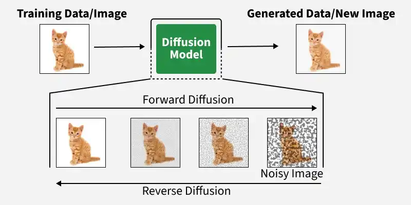
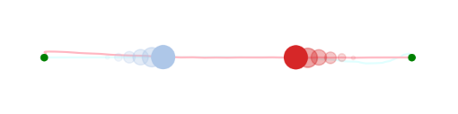
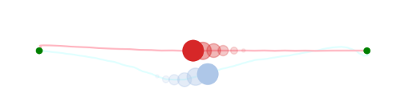

Notes on: https://openreview.net/forum?id=AUCYptvAf3

```text
Diffusion models have recently been successfully applied to a wide range of robotics applications for learning complex multi-modal behaviors from data. However, prior works have mostly been confined to single-robot and small-scale environments due to the high sample complexity of learning multi-robot diffusion models. In this paper, we propose a method for generating collision-free multi-robot trajectories that conform to underlying data distributions while using only single-robot data. Our algorithm, Multi-robot Multi-model planning Diffusion (MMD), does so by combining learned diffusion models with classical search-based techniques---generating data-driven motions under collision constraints. Scaling further, we show how to compose multiple diffusion models to plan in large environments where a single diffusion model fails to generalize well. We demonstrate the effectiveness of our approach in planning for dozens of robots in a variety of simulated scenarios motivated by logistics environments.
````

Diffusion models are models that begin from random noise and slowly refine it into meaningful output. These models learn how to create data by removing unwanted noise from inputs.



The paper proposes an algorithm: "**Muli-robot Multi-model planning Diffusion**" (MMD).

The approach calls for learning from only a single robot. MMD generates collision-free trajectories via special "spatio-temporal guiding functions."


Initially, two robots want to swap positions.


Diffusion denoising black magic.


A collision free solution is generated.

What's going on here is that the paper uses conflict based search. For each robot a single trajectory is built by sampling its diffusion model. 

Absolutely incomprehensible. 10/10