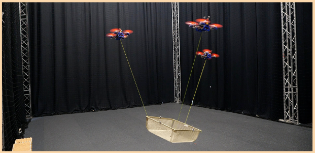

Notes on: https://arxiv.org/pdf/2510.17143

```text
Abstract— Existing approaches for transporting and ma-
nipulating cable-suspended loads using multiple UAVs along
reference trajectories typically rely on either centralized control
architectures or reliable inter-agent communication. In this
work, we propose a novel machine learning–based method for
decentralized kinodynamic planning that operates effectively
under partial observability and without inter-agent commu-
nication. Our method leverages imitation learning to train
a decentralized student policy for each UAV by imitating
a centralized kinodynamic motion planner with access to
privileged global observations. The student policy generates
smooth trajectories using physics-informed neural networks
that respect the derivative relationships in motion. During
training, the student policies utilize the full trajectory generated
by the teacher policy, leading to improved sample efficiency.
Moreover, each student policy can be trained in under two
hours on a standard laptop. We validate our method in both
simulation and real-world environments to follow an agile
reference trajectory, demonstrating performance comparable
to that of centralized approaches.
````

UAVs are unmanned aerial vehicles. So drones. An individual drone can't carry that much weight, necessitating the use of multiple drones. The paper discusses drones that use cables to attach to their payload.



I am more interested in the machine learning aspect of the proposed solution.

The paper proceeds to define notation and discusses how the mechanical parts are all set up.

Then it discusses the proposed control policy.

The teacher policy solves an optimization problem and generates a reference trajectory.

Accounting for external forces and other variables, the UAVs attempt to follow this trajectory.
This centralized method requires knowledge on the full states of all UAVs and the load. That's where our student policy comes in—generating only the trajectories for its own state and the load's pose.

The paper then brings out some math that I don't want to read.

Policies are trained using a simulated environment. 

I don't understand anything after that. 😔

10/10 paper.